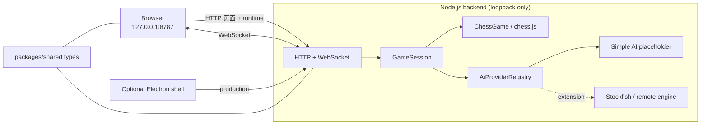

# Nocturne Chess

> 一座安静的三维棋艺工作室 —— 可直接在本机浏览器运行的 React + Three.js 3D 国际象棋，附带可选 Electron 桌面壳。

[](https://github.com/tianmingbuaa/electron-3d-chess/actions/workflows/ci.yml)
[](https://github.com/tianmingbuaa/electron-3d-chess/actions/workflows/release.yml)

Nocturne Chess 现在是一个**浏览器优先**的国际象棋 Web 应用。它将**权威棋规与 AI 服务**放在独立的 Node.js 后端，把**高品质 3D 棋盘、程序化棋子和完整交互**放在 React / WebGL 前端，通过类型化 WebSocket 协议通信。只需在本机运行一个命令，即可打开浏览器单人试玩；Electron 桌面封装作为可选能力保留。

## 特性

- **优雅的 3D 棋室**：程序化建模的六种棋子、胡桃木/大理石材质、真实阴影与反射环境，无任何外部模型或贴图依赖。
- **GPU 优先的渲染**：Three.js / React Three Fiber、PBR 材质、软阴影、环境光照、对象复用与像素比上限，保证高刷新率下流畅。
- **两种对弈模式**：本地人人对弈、人机对弈（人机可执白/执黑）。
- **可替换的 AI 引擎**：内置一个基于 alpha-beta 的占位引擎，同时提供稳定的 `AiProvider` SPI（服务提供接口）、能力声明、超时/取消与注册表。后续可接入 Stockfish、远程推理服务等。
- **权威棋局服务**：后端使用 `chess.js` 校验并执行走法，支持将杀、逼和、三次重复、五十回合、子力不足、升变、王车易位、吃过路兵、悔棋、认输。
- **沉浸式交互**：点击选子、合法落点提示、棋子弧线移动、被吃棋子粒子闪光、将军高亮、棋盘翻转、合成音效。
- **浏览器优先，桌面可选**：`pnpm web` 构建并在本机启动浏览器版，默认打开系统浏览器；无需登录、账号或 HTTPS。Electron 主进程与 electron-builder 桌面封装继续保留。
- **健壮性**：WebSocket 自动重连、错误提示、3D 渲染失败时自动降级为可玩的 2D 棋盘。

## 截图


*浏览器实际运行：Brave/Chromium 以 1440 × 960 加载本地 Web 服务。棋盘、棋子、PBR 材质与界面均由离线程序化资源生成。*

## 技术栈

| 层 | 技术 |
| --- | --- |
| Web runtime | 现代浏览器（Chromium/Firefox/Safari）、ES2022、WebGL |
| Renderer | React 19、Vite 8、TypeScript |
| 3D | Three.js 0.186、@react-three/fiber、@react-three/drei |
| State | Zustand |
| Backend | 本地 Node.js、`ws`、chess.js |
| Protocol | 共享 TypeScript 类型 + JSON over WebSocket |
| Desktop（可选） | Electron 45、electron-builder |
| Test | Vitest |
| Tooling | pnpm workspace、tsup |

## 快速开始（浏览器模式，推荐）

要求 Node.js ≥ 24、pnpm ≥ 12。

```bash
pnpm install
pnpm web
```

`pnpm web` 会完成 Web 构建、在 **`127.0.0.1:8787`** 启动本地棋局服务，并尝试打开系统默认浏览器。如果没有自动打开，手动访问：

**http://127.0.0.1:8787/**

无需注册、登录、用户认证或 HTTPS；服务只监听本机回环地址。打开后默认为本地棋盘，点击右侧「人机对弈」即可和内置 AI 单人试玩。

常用浏览器命令：

```bash
pnpm web:dev            # 开发模式：后端 :8787 + Vite :5173（浏览器访问 :5173）
pnpm web:build          # 只构建 Web 前端与后端
pnpm web:serve          # 运行已构建的 Web 版本（不自动打开浏览器）
CHESS_PORT=8788 pnpm web:serve
CHESS_NO_OPEN=1 pnpm web

pnpm typecheck
pnpm test
```

浏览器模式的启动说明、原理、兼容性与排障见 [Web 运行指南](docs/WEB.md)。

## 桌面模式（可选）

原有 Electron 运行方式继续保留：

```bash
# 开发：后端 + Vite + Electron 三进程
pnpm dev

# 生产构建并启动 Electron 桌面窗口
pnpm build
pnpm start

# 打包当前平台的安装包
pnpm dist
pnpm dist:linux     # Linux AppImage
pnpm dist:windows   # Windows NSIS
pnpm dist:macos     # macOS DMG（x64 + arm64）
pnpm dist:dir       # 只生成未打包目录

# 真实 Electron 窗口截图（视觉冒烟测试）
pnpm screenshot
```

首次桌面开发会下载 Electron 二进制；Web 模式本身不依赖 Electron 运行时。

## 跨平台构建与发布

仓库包含两条 GitHub Actions 工作流：

- **CI**：`main` push / PR 时在 Linux 上执行类型检查、32 项测试、生产构建，并启动一次浏览器 Web 服务 smoke 检查；
- **Release**：推送 `v*` tag 时，在 Ubuntu、Windows、macOS 原生 runner 上并行构建 AppImage、NSIS 与两个 DMG，全部成功后自动创建 GitHub Release 并附加 `SHA256SUMS.txt`。浏览器模式无需安装包，`pnpm web` 即可本地运行。

```bash
# 版本号同步后，用 tag 触发三平台发布
git tag v1.0.0
git push origin v1.0.0
```

产物命名统一为 `nocturne-chess-<version>-<os>-<arch>.<ext>`。当前 CI 构建**未签名**，macOS Gatekeeper 与 Windows SmartScreen 可能要求用户手动放行；签名、发布权限和手动构建方法见 [跨平台发布指南](docs/RELEASING.md)。

## 操作

| 操作 | 方式 |
| --- | --- |
| 选择 / 走棋 | 点击己方棋子，再点击高亮目标格 |
| 悔棋 | 面板按钮、`U` 或 `Ctrl/Cmd + Z` |
| 重新开始 | 面板「新局」或 `N` |
| 翻转棋盘 | 右上角按钮或 `F` |
| 声音开关 | 右上角按钮或 `M` |
| 取消选择 / 关闭面板 | `Esc` |
| 自由观察 | 鼠标左键拖拽旋转、滚轮缩放（已限制角度与距离） |

## 项目结构

```
apps/
  desktop/          Electron 主进程、preload、窗口与后端生命周期
  server/           棋局引擎、会话、WebSocket/HTTP 服务、AI provider
  web/              React + Three.js 渲染器
packages/
  shared/           前后端共享的领域类型和协议定义
.github/
  workflows/
    ci.yml          Linux CI：typecheck / test / build
    release.yml     三平台构建与 tag 发布
build/
  icon.png          跨平台源图标
  icon.ico          Windows 多尺寸图标
docs/
  ARCHITECTURE.md   架构、数据流、安全与性能设计
  PROTOCOL.md       WebSocket / HTTP 协议参考
  AI_EXTENSION.md   AI 引擎扩展开发指南
  WEB.md            浏览器运行、端口、兼容性、本地排障
  TESTING.md        类型/测试/截图/交互验收方法
  RELEASING.md      GitHub Actions 跨平台构建、签名与发布
  ROADMAP.md        分阶段开发路线与后续方向
scripts/
  serve-web.mjs     本地浏览器 Web 服务启动器
  capture.sh        Electron 截图冒烟脚本
```

## 架构概览



浏览器模式下，同一个 Node.js 进程提供静态前端、`/api/runtime` 与 `/ws`，因此浏览器只需访问一个 HTTP 地址即可；开发时使用 Vite 代理，生产时由后端直接托管构建产物。Electron 模式复用同一个后端与前端，只把窗口壳作为可选能力。游戏操作**不经过 Electron IPC**，所以浏览器能够完全独立运行，也便于测试和调试。

渲染器只发送意图（`move`、`undo`、`new_game` 等）；服务器返回完整权威快照（64 格合法走法、稳定的棋子 ID、棋谱、将军状态、结果）。前端无法改变棋局结果。

更多细节见 [架构说明](docs/ARCHITECTURE.md) 与 [协议参考](docs/PROTOCOL.md)。

## AI 说明

内置的 **Simple Atelier Engine** 是一个刻意保持简单的占位实现：材料评估 + 轻量位置表 + alpha-beta，难度对应 1/2/3 层搜索。它用于验证交互链路，而不是提供竞技强度。

生产级 AI 扩展步骤：

1. 实现 `AiProvider`（见 `packages/shared/src/index.ts`）。
2. 在创建后端时通过 `createChessServer({ aiProviders: [...] })` 注册，或扩展服务器默认注册表。
3. 实现方必须尊重 `AbortSignal`、`timeLimitMs`，返回合法走法；服务端会再次校验。
4. 详见 [AI 扩展开发文档](docs/AI_EXTENSION.md)。

## 开发路线

分阶段计划、当前完成度与后续增强方向见 [ROADMAP.md](docs/ROADMAP.md)。测试、无头截图与自动化脚本用法见 [TESTING.md](docs/TESTING.md)，GitHub Actions 发布流程见 [RELEASING.md](docs/RELEASING.md)。

## 质量验证

本项目交付时通过了：

- 全 workspace `tsc --noEmit`；
- 后端 **32 项** Vitest（棋规、AI provider、WebSocket/HTTP 集成）；
- Vite 生产构建与 Electron 主进程打包；
- `pnpm web:build` 浏览器构建、`pnpm web:serve` 本地静态/HTTP/WS 服务；
- Brave/Chromium 1440 × 960 真实浏览器渲染；Firefox 页面结构正常加载；
- 浏览器原生 WebSocket（Node 24 全局 API）完成 `welcome`、棋盘状态与 `e2 → e4` 对局；
- 开发模式下 Vite HTTP/WS 代理的真实链路；
- Electron 实机、`electron-builder --dir` 与 Linux AppImage 产物启动；
- macOS/Windows 原生构建配置、平台图标、应用菜单与 Windows AppUserModelID；
- GitHub Actions 三平台构建矩阵与 tag 驱动 Release 工作流；首轮 CI 与 Windows/macOS/Linux 原生构建冒烟均通过，CI 现已加入浏览器 Web 服务 smoke；
- 真实 Canvas 指针事件端到端：点击 e2 → e4 成功落子；
- AI 执白自动落子、黑方视角翻转、窄窗抽屉面板、终局弹窗与 2D 降级棋盘截图；
- 完整场景 3 秒帧率采样 **60.2 FPS**（p95 帧时间 16.8ms，1024×653/DPR 1）。

## 已知边界

- Web 模式是“本机 Node 后端 + 浏览器页面”，不是只上传静态文件即可运行的纯静态站点；若要部署到远端，需要同时部署后端并调整访问控制。
- 不包含登录、账号、云存档、多人联机或 HTTPS；按需求仅面向本机单人试玩。
- 对局仅保存在当前 WebSocket 连接内；后端重启/刷新页面会开始新对局。
- 内置 AI 是占位引擎，适合验证完整链路，不追求棋力。
- 暂无时钟、PGN、复盘、联机对战；路线图见 [ROADMAP](docs/ROADMAP.md)。
- 发布配置提供 Linux AppImage、Windows NSIS（非管理员安装）与 macOS x64/arm64 DMG；Linux AppImage 与解包目录已在本机实际启动验证，Windows/macOS 由 GitHub Actions 原生 runner 构建。
- 跨平台 CI 产物默认未签名；正式分发建议配置 Apple Developer ID/notarization 与 Windows Authenticode，详见 [RELEASING.md](docs/RELEASING.md)。
- 本次已完成三平台原生构建验证，但**没有自动创建正式 GitHub Release**；推送 `v*` tag（或从 tag ref 手动运行工作流）后由 Release job 发布。

## License

[MIT](LICENSE)
