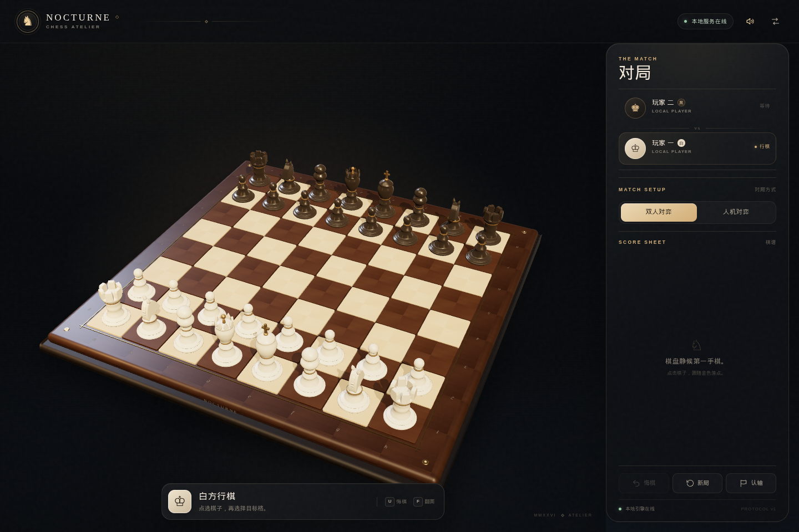
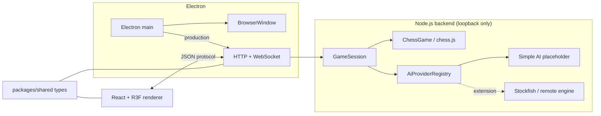

# Nocturne Chess

> 一座安静的三维棋艺工作室 —— 基于 Electron + React + Three.js 的 GPU 加速国际象棋游戏。

Nocturne Chess 是一个桌面端国际象棋游戏。它将**权威棋规与 AI 服务**放在独立的 Node.js 后端，把**高品质 3D 棋盘、程序化棋子和完整交互**放在 React / WebGL 前端，通过类型化 WebSocket 协议通信。

## 特性

- **优雅的 3D 棋室**：程序化建模的六种棋子、胡桃木/大理石材质、真实阴影与反射环境，无任何外部模型或贴图依赖。
- **GPU 优先的渲染**：Three.js / React Three Fiber、PBR 材质、软阴影、环境光照、对象复用与像素比上限，保证高刷新率下流畅。
- **两种对弈模式**：本地人人对弈、人机对弈（人机可执白/执黑）。
- **可替换的 AI 引擎**：内置一个基于 alpha-beta 的占位引擎，同时提供稳定的 `AiProvider` SPI（服务提供接口）、能力声明、超时/取消与注册表。后续可接入 Stockfish、远程推理服务等。
- **权威棋局服务**：后端使用 `chess.js` 校验并执行走法，支持将杀、逼和、三次重复、五十回合、子力不足、升变、王车易位、吃过路兵、悔棋、认输。
- **沉浸式交互**：点击选子、合法落点提示、棋子弧线移动、被吃棋子粒子闪光、将军高亮、棋盘翻转、合成音效。
- **完整的桌面封装**：开发模式前后端独立进程，生产模式 Electron 主进程托管本地后端并加载打包前端；提供 electron-builder 打包配置。
- **健壮性**：WebSocket 自动重连、错误提示、3D 渲染失败时自动降级为可玩的 2D 棋盘。

## 截图

> 构建后运行 `pnpm screenshot`，截图会写入 `artifacts/nocturne-chess.png`。



*实际 Electron 窗口，1440 × 960；棋盘、棋子、PBR 材质与界面均由离线程序化资源生成。*

## 技术栈

| 层 | 技术 |
| --- | --- |
| Desktop | Electron 45、TypeScript |
| Renderer | React 19、Vite 8、TypeScript |
| 3D | Three.js 0.186、@react-three/fiber、@react-three/drei |
| State | Zustand |
| Backend | Node.js、`ws`、chess.js |
| Protocol | 共享 TypeScript 类型 + JSON over WebSocket |
| Test | Vitest |
| Package | pnpm workspace、tsup、electron-builder |

## 快速开始

要求 Node.js ≥ 24、pnpm ≥ 12。

```bash
pnpm install

# 开发：后端 :8787 + Vite :5173 + Electron
pnpm dev
```

首次启动会下载 Electron 二进制。开发模式下三个进程相互独立：后端使用 `tsx watch`，前端由 Vite HMR 承载，Electron 只负责窗口壳；Vite 将 `/api` 与 `/ws` 代理至本地后端。

```bash
# 生产构建并启动（Electron 主进程会启动后端，加载静态前端）
pnpm build
pnpm start

# 打包安装包（electron-builder）
pnpm dist

# 只生成未打包目录，便于检查产物
pnpm dist:dir

# 全量类型检查 / 测试
pnpm typecheck
pnpm test

# 真实 Electron 窗口截图（视觉冒烟测试）
pnpm screenshot
```

## 操作

| 操作 | 方式 |
| --- | --- |
| 选择 / 走棋 | 点击己方棋子，再点击高亮目标格 |
| 悔棋 | 面板按钮、`U` 或 `Ctrl/Cmd + Z` |
| 重新开始 | 面板「新局」或 `N` |
| 翻转棋盘 | 右上角按钮或 `F` |
| 声音开关 | 右上角按钮或 `M` |
| 取消选择 / 关闭面板 | `Esc` |
| 自由观察 | 鼠标左键拖拽旋转、滚轮缩放（已限制角度与距离） |

## 项目结构

```
apps/
  desktop/          Electron 主进程、preload、窗口与后端生命周期
  server/           棋局引擎、会话、WebSocket/HTTP 服务、AI provider
  web/              React + Three.js 渲染器
packages/
  shared/           前后端共享的领域类型和协议定义
docs/
  ARCHITECTURE.md   架构、数据流、安全与性能设计
  PROTOCOL.md       WebSocket / HTTP 协议参考
  AI_EXTENSION.md   AI 引擎扩展开发指南
  TESTING.md        类型/测试/截图/交互验收方法
  ROADMAP.md        分阶段开发路线与后续方向
scripts/
  capture.sh        Electron 截图冒烟脚本
```

## 架构概览



开发时后端由独立进程提供；生产时 Electron 主进程以临时端口启动同一个后端，并将窗口指向它。游戏操作**不经过 Electron IPC**，因此后端也可以单独运行，便于测试、调试或将来替换为远程对战服务。

渲染器只发送意图（`move`、`undo`、`new_game` 等）；服务器返回完整权威快照（64 格合法走法、稳定的棋子 ID、棋谱、将军状态、结果）。前端无法改变棋局结果。

更多细节见 [架构说明](docs/ARCHITECTURE.md) 与 [协议参考](docs/PROTOCOL.md)。

## AI 说明

内置的 **Simple Atelier Engine** 是一个刻意保持简单的占位实现：材料评估 + 轻量位置表 + alpha-beta，难度对应 1/2/3 层搜索。它用于验证交互链路，而不是提供竞技强度。

生产级 AI 扩展步骤：

1. 实现 `AiProvider`（见 `packages/shared/src/index.ts`）。
2. 在创建后端时通过 `createChessServer({ aiProviders: [...] })` 注册，或扩展服务器默认注册表。
3. 实现方必须尊重 `AbortSignal`、`timeLimitMs`，返回合法走法；服务端会再次校验。
4. 详见 [AI 扩展开发文档](docs/AI_EXTENSION.md)。

## 开发路线

分阶段计划、当前完成度与后续增强方向见 [ROADMAP.md](docs/ROADMAP.md)。测试、无头截图与自动化脚本用法见 [TESTING.md](docs/TESTING.md)。

## 质量验证

本项目交付时通过了：

- 全 workspace `tsc --noEmit`；
- 后端 **32 项** Vitest（棋规、AI provider、WebSocket/HTTP 集成）；
- Vite 生产构建与 Electron 主进程打包；
- 开发模式下 Vite HTTP/WS 代理的真实链路；
- Electron 实机、`electron-builder --dir` 与 Linux AppImage 产物启动；
- 真实 Canvas 指针事件端到端：点击 e2 → e4 成功落子；
- AI 执白自动落子、黑方视角翻转、窄窗抽屉面板、终局弹窗与 2D 降级棋盘截图；
- 完整场景 3 秒帧率采样 **60.2 FPS**（p95 帧时间 16.8ms，1024×653/DPR 1）。

## 已知边界

- 对局仅保存在当前 WebSocket 连接内；后端重启/断线重连会开始新对局。
- 内置 AI 是占位引擎，适合验证完整链路，不追求棋力。
- 暂无时钟、PGN、复盘、联机对战；路线图见 [ROADMAP](docs/ROADMAP.md)。
- 发布配置提供 Linux AppImage / Windows NSIS / macOS DMG；本次实际验证了 Linux AppImage（`release/Nocturne Chess-1.0.0.AppImage`，约 121 MB）与解包目录。

## License

[MIT](LICENSE)
