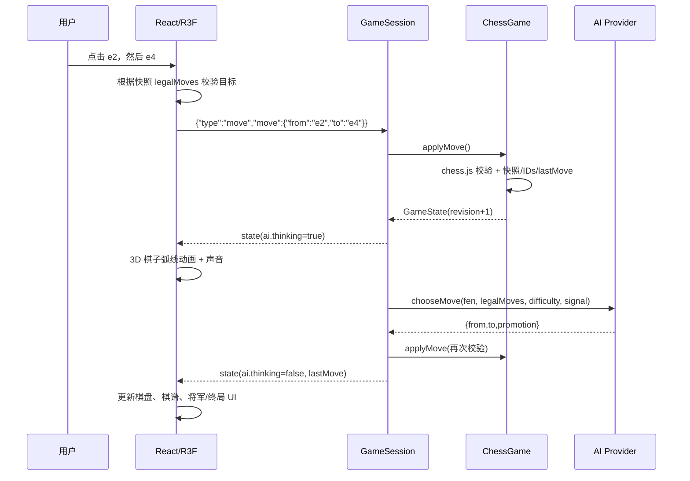

# 架构说明

## 目标

Nocturne Chess 的目标不是一个“单文件 Electron demo”，而是一个可维护的**浏览器优先**棋类应用基线：

1. **权威规则在后端**：渲染器永远不能私自修改棋局。
2. **前后端真正解耦**：二者通过类型化协议通信，后端可脱离 Electron 独立运行。
3. **AI 是可替换的基础设施**：占位引擎只占一个 provider 槽位，扩展时无需改动 UI 协议。
4. **视觉与帧率优先**：3D 资源全部程序化、零网络素材依赖；渲染参数在清晰度与 GPU 负载间取平衡。
5. **浏览器本地体验完整**：一条命令构建、启动并在本机浏览器试玩；Electron 仅作为可选的桌面封装。

## 进程与部署拓扑

### 浏览器模式（默认试玩路径）

```text
pnpm web
├─ pnpm web:build
│  ├─ apps/web/dist         React + Three.js 静态资源
│  └─ apps/server/dist      本地后端
└─ scripts/serve-web.mjs
   └─ createChessServer({ host: '127.0.0.1', port: 8787, staticDir: apps/web/dist })
      ├─ GET /               静态页面 + favicon/assets
      ├─ GET /api/runtime    自动下发内部 WebSocket token 与路径
      ├─ GET /api/health
      └─ WS /ws              权威棋局与 AI
```

- 一个 Node.js 进程同源提供前端、API 与 WebSocket，浏览器只需访问 `http://127.0.0.1:8787/`。
- 运行时通过系统默认浏览器打开页面；无图形会话时只打印 URL。
- 面向本机单人试玩：无账号、无登录、无多人房间、无 HTTPS。
- 浏览器端不依赖 Electron API；macOS 浏览器也不会套用 Electron 交通灯留白。
- 页面刷新会建立新连接与新的内存对局，这是当前单机会话模型的一部分。

### Electron 开发模式（可选）

```text
pnpm dev
├─ @nocturne/chess-server  tsx watch src/cli.ts        127.0.0.1:8787
├─ @nocturne/chess-web     vite                       127.0.0.1:5173  (proxy /api, /ws)
└─ electron .              CHESS_RENDERER_URL=http://127.0.0.1:5173
```

- Vite 的代理使渲染器始终使用相对地址 `/api/runtime` 与 `/ws`，开发和生产代码路径一致。
- Electron 主进程此时**不启动内置后端**，只负责窗口、安全策略与 shell。
- 后端可以单独启动：`pnpm --filter @nocturne/chess-server dev`。

### Electron 生产模式（可选）

```text
electron main
├─ createChessServer({ port: 0, staticDir: resources/web })
│  ├─ /api/health, /api/runtime
│  ├─ /ws?token=…
│  └─ 静态文件：apps/web/dist → resources/web
└─ BrowserWindow.loadURL(http://127.0.0.1:<随机端口>)
```

- 只绑定 `127.0.0.1`，端口随机，避免与用户其它服务冲突。
- 首次请求 `/api/runtime` 取得内部 WebSocket token 与路径，渲染器随后连接。
- 页面与 API 同源，因此无需 CORS；没有暴露到局域网的监听。
- 应用退出时优雅关闭 HTTP/WS 服务。

### 为什么不用 Electron IPC 传棋局？

Electron IPC 很适合文件对话框、系统能力等桌面 API，但把棋局协议绑定到 IPC 会让后端无法脱离 Electron、难以做黑盒测试，也不利于浏览器模式或将来替换为远程对战。

浏览器模式完全不需要 IPC；Electron 模式也只把 **桌面外壳能力**（版本、平台）放在 preload/IPC。棋局全部走标准 HTTP/WebSocket，因此两种运行方式共享完全相同的业务代码。preload 保持 `contextIsolation: true`、`sandbox: true`、`nodeIntegration: false`。

## 分层

```text
packages/shared
├─ 领域类型 GameState / MoveRecord / PieceState
├─ 客户端消息 ClientMessage
├─ 服务端消息 ServerMessage
├─ AI SPI AiProvider / AiMoveRequest / AiMoveChoice
└─ 运行时与健康检查 DTO

apps/server
├─ chess-game.ts        权威规则、稳定棋子 ID、快照/悔棋
├─ session.ts           单个连接的对局生命周期、AI 调度
├─ protocol.ts          入站消息校验与响应封装
├─ ai/registry.ts       provider 注册、能力校验
├─ ai/simple-provider.ts 占位 alpha-beta 引擎
├─ static.ts            SPA 静态文件服务
└─ index.ts             公开 createChessServer API

apps/web
├─ lib/socket.ts        重连、runtime token、类型化收发
├─ lib/runtime.ts       同源 runtime 解析
├─ store/gameStore.ts   权威快照 → UI 状态、选择、音效、提示
├─ components/          侧栏、顶栏、对话、状态浮层
├─ scene/               Three.js 场景、程序化棋盘/棋子、2D 降级
└─ public/              favicon / Apple touch icon

scripts
└─ serve-web.mjs        浏览器单机模式的本地启动器（构建产物 + API + WS）

.github/workflows
├─ ci.yml               main/PR 的类型、测试、构建检查
└─ release.yml          三平台原生构建 + tag Release
```

## 核心数据流：走一步棋



关键约束：

- 每次状态变更发送**完整快照**，不做增量补丁。32 个棋子的状态体量很小，完整快照让重连、回放和调试更简单。
- `revision` 单调递增，前端可用来丢弃过期响应（当前实现主要用作快照标识）。
- 棋子 `id` 在移动与升变中保持稳定，使前端可以对同一刚体进行连续动画；被吃/悔棋恢复时也保持一致。
- `legalMoves` 按起点聚合，前端只负责展示，不承担棋规判断。

## 3D 与性能设计

### 场景

- **棋盘**：64 块挤出圆角格 + 圆角基座 + 黄铜嵌线 + 四个脚垫 + Canvas 生成的坐标/铭牌纹理。
- **棋子**：六类棋子全部由 `LatheGeometry`、`ExtrudeGeometry`、圆柱/球体等程序化构建；白方暖象牙，黑方烟熏黑曜石，少量黄铜细节。
- **材质**：`MeshPhysicalMaterial`（clearcoat / roughness / metalness），程序化胡桃木与大理石纹理，不依赖网络 HDR/GLB。
- **灯光**：暖色主方向光投射 2048 阴影、冷色补光、暖色点光、环境立方反射；`ContactShadows` 提供接触暗部。
- **氛围**：微尘粒子、CSS 渐晕、无外部贴图。全部离线可复现。

### 帧率策略

| 措施 | 说明 |
| --- | --- |
| 几何复用 | 单元格几何、棋子几何、棋标纹理均为模块级缓存 |
| 材质共享 | 棋子材质在模块级创建，避免 32 份 shader |
| 像素比上限 | `dpr={[1, 1.75]}`，高分屏仍然清晰但不过度填充 |
| 阴影控制 | 主方向光 2048；接触阴影 512 且只烘焙一次；聚光灯只照明不重复投影；不使用实时反射探针 |
| 环境只烘焙一次 | `Environment frames={1}` / 低分辨率 PMREM；静态接触阴影同样 `frames={1}` |
| 动画阻尼 | 所有逐帧动画只修改 transform，不重新创建对象 |
| React 更新隔离 | hover/selected 等只触发轻量重渲染，Three.js 对象保持引用 |
| 降级 | WebGL/场景崩溃自动落入 2D 棋盘，游戏仍可继续 |

如果面向低端集显，可进一步将 `dpr` 上限降至 1.5、关闭 `Sparkles`、把方向光阴影贴图降到 1024；这些点都集中在 `apps/web/src/scene/ChessScene.tsx`。

当前环境实测：在 1024×653 画布、DPR=1、完整 32 枚棋子和连续动画下，3 秒 `requestAnimationFrame` 采样为 **60.2 FPS**，p95 帧时间 16.8ms。采样方法是 `scripts/automation/fps.js`。

## 状态与交互

`gameStore` 消费服务端快照并派生 UI 状态：

- `selected` 只允许己方、当前轮到的一方；
- 合法目标来自 `GameState.legalMoves[selected]`；
- AI 思考、终局、非人类回合时禁止落子；
- 升变先打开选择对话框，确认后才发送 `move`；
- 悔棋在 AI 模式下由后端恢复至人类回合，前端只发意图；
- 结果弹窗以“局面 + 结果”为键，可关闭后继续查看棋盘；
- 声音由 WebAudio 程序合成，首次用户手势后解锁。

## 跨平台兼容性

- 浏览器构建目标为 ES2022，不依赖 Electron 专属 API；macOS 顶部交通灯留白只在检测到 Electron bridge 后启用。
- 前端图标使用本地 favicon；静态服务为浏览器提供正确的 MIME、缓存与 CSP 头。
- 所有主进程与后端文件路径通过 `node:path` 构造；用户目录、ASAR 内的 `__dirname` 与 `process.resourcesPath` 分别适配 macOS `.app/Contents/Resources` 与 Windows/Linux `resources/`。
- 静态服务器使用规范化路径 + realpath 边界检查，并在 URL 层拒绝反斜杠、盘符、`..` 与隐藏段，因此 Windows 路径语义不会绕过根目录。
- Windows：`AppUserModelID` 与 `appId` 一致；NSIS 使用 ICO、多尺寸图标与非管理员安装模式。
- macOS：恢复原生 app/file/edit/window 菜单，保证 Cmd+Q、Cmd+W、复制粘贴等标准快捷键；`hiddenInset` 标题栏交由系统交通灯布局。
- Linux：AppImage + freedesktop desktopName/WM_CLASS 同步。
- `.gitattributes` 强制 shell/workflow 使用 LF，防止 Windows checkout 的 CRLF 破坏脚本。
- CI 在三种原生 runner 上先跑同一套 typecheck/test/build，再由 electron-builder 在对应平台打包，不做不可靠的跨平台交叉打包。
- CI 产物默认未签名；生产分发应补 Apple Developer ID/notarization 与 Windows Authenticode（见 `docs/RELEASING.md`）。

## 安全

- **浏览器模式**没有登录/账号概念，也不要求 HTTPS；服务固定绑定 `127.0.0.1`，不对局域网开放。
- `/api/runtime` 下发的随机 token 仅是本地 WebSocket 的内部卫生措施（防止其它网页随意连接），不是用户认证，用户无感知。
- **Electron 模式**：`contextIsolation`、`sandbox` 开启，渲染器无 Node 权限；外部链接在系统浏览器打开，窗口内导航被阻止。
- 两种模式都由后端设置 CSP，禁止对象、表单、frame 注入；脚本仅同源（开发期 Vite 需 inline preamble，因此 meta 允许 inline）。
- HTTP/WS 只监听回环地址。
- 静态文件服务做路径规范化，阻止目录逃逸（见 `apps/server/src/static.ts`）。
- Electron 45 自带 Chromium sandbox；打包配置不请求额外系统权限。

## 失败处理

- 连接断开：指数退避重连，重新获取 token；游戏区显示恢复提示。
- 后端重启或浏览器刷新：当前内存对局丢失，握手后会得到一局新的默认棋局。
- 非法请求：服务端返回结构化错误，不关闭连接、不破坏对局。
- AI 异常/超时：回到可操作状态并给出错误，不阻塞后续走棋。
- 3D 失败：错误边界切换 CSS 棋盘，仍然可以完成对局。

## 扩展建议

1. **持久化棋局**：在 `GameSession` 外增加 session store（SQLite），重连时按 session id 恢复。
2. **AI 子进程**：将 UCI Stockfish 放入 worker/child process，provider 只做协议桥接，避免搜索阻塞事件循环。
3. **复盘/计时**：快照已经包含完整 history，可扩展 PGN 导入导出和时钟字段。
4. **联机对战**：把 WebSocket 层替换为房间路由，同一 `GameSession` 可挂多个观众/玩家连接。
5. **多语言**：UI 文案目前集中在组件与 `lib/pieces.ts`，可迁移到 i18n 字典。
6. **远端 Web 部署**：若要公开访问，需补充鉴权、房间隔离、HTTPS/TLS 终止与持久化；这与本期“本机单人试玩”边界不同。
