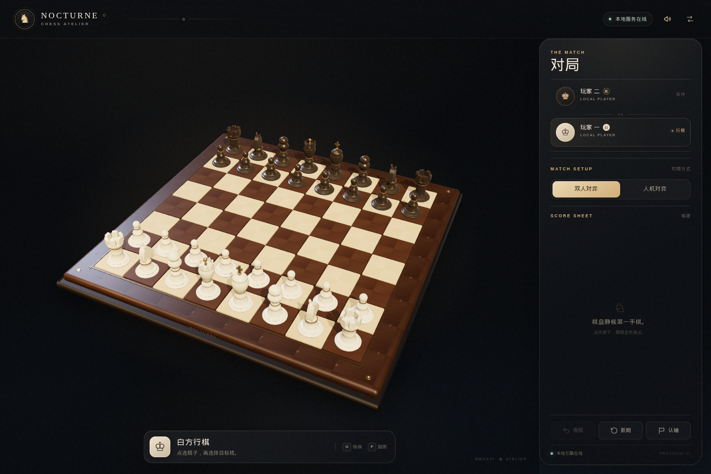
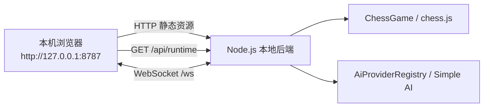

# 浏览器模式



Nocturne Chess 现在可以脱离 Electron，直接在本机浏览器中运行。这是面向“打开网页、单人试玩”的最小本地 Web 模式，不包含用户注册、登录、房间或 HTTPS 部署。

## 1. 一键运行

要求 Node.js ≥ 24、pnpm ≥ 12。

```bash
pnpm install
pnpm web
```

`pnpm web` 会：

1. 构建 Web 前端和本地 Node 后端；
2. 在 `127.0.0.1:8787` 启动本地棋局服务；
3. 尝试用系统默认浏览器打开 `http://127.0.0.1:8787/`；
4. 在关闭自动打开或没有图形环境时，打印同一个地址供手动打开。

如果浏览器没有自动打开，直接访问：

```text
http://127.0.0.1:8787/
```

停止服务：在终端按 `Ctrl+C`。

### 单人试玩

- 默认打开的是本地棋盘，可以直接在同一个网页内移动双方棋子；
- 点击右侧「人机对弈」，选择执白/执黑与棋力，即可与内置 AI 对弈；
- 适合本机单人试玩，同一个页面中没有任何登录或账号步骤。

## 2. 命令

| 命令 | 用途 |
| --- | --- |
| `pnpm web` | 构建并启动浏览器版；自动打开默认浏览器 |
| `pnpm web:serve` | 启动已经构建好的浏览器版（不自动打开） |
| `pnpm web:dev` | 开发模式：后端 `:8787` + Vite `:5173`，热更新 |
| `pnpm web:build` | 只构建 Web 前端与后端，不构建 Electron |
| `CHESS_PORT=8788 pnpm web:serve` | 使用其它端口 |
| `CHESS_NO_OPEN=1 pnpm web` | 禁止自动打开浏览器 |

开发模式：

```bash
pnpm web:dev
# 浏览器访问 http://127.0.0.1:5173/
```

Vite 将 `/api`、`/ws` 代理给本地后端；关闭命令后两个进程都会被清理。无需启动 Electron。

## 3. 工作原理



- 前端仍然是 `apps/web` 的 React + Three.js 渲染器；
- 后端仍然是 `apps/server` 的权威棋规、会话与 AI 服务；
- 后端在同一个端口提供静态文件和 API，因此浏览器端只需要一个地址；
- 服务端只绑定 `127.0.0.1`，不会监听局域网；
- 使用普通 HTTP，不需要 HTTPS、证书或反向代理；
- 不需要账号、登录、用户资料或多人房间。

### 内部令牌说明

`/api/runtime` 会向同源页面下发一个随机的 WebSocket token。它**不是用户认证**，也不会让用户看到或手动输入；它的作用仅是防止本机上其它任意网页随意连接棋局服务。浏览器模式保持这一内部卫生措施，但不引入任何登录流程。

## 4. 浏览器兼容性

- 使用现代浏览器：Chromium 系（Chrome、Edge、Brave）、Firefox、Safari 的较新版本；
- 构建目标为 `es2022`，不依赖 Electron 专属 API；
- 3D 场景优先使用 WebGL；WebGL 不可用时自动切换到可玩的 2D 棋盘；
- 页面在 macOS 浏览器中不会套用 Electron 的交通灯留白；
- 已在 Brave/Chromium 无头浏览器完成 1440×960 实际渲染和浏览器原生 WebSocket 对局验证，也验证了 Firefox 能加载页面与界面。

### 本次实测

| 项 | 结果 |
| --- | --- |
| Web 构建 | `pnpm web:build` 通过 |
| 页面与静态资源 | `/`、`/favicon.png`、assets 正常 |
| 浏览器原生 WebSocket | Node 24 全局 `WebSocket` 登录、走 `e2→e4` 成功 |
| Chromium 实际渲染 | Brave headless 1440×960，3D 棋盘完整显示 |
| Firefox 页面加载 | 页面结构与样式正常加载 |
| 无 Electron 运行 | 浏览器路径不依赖 Electron 窗口 |

## 5. 与 Electron 模式的关系

- **浏览器模式是新增的默认试玩路径**：`pnpm web`；
- Electron 模式保留，供需要独立桌面安装包时使用：`pnpm dev`、`pnpm start`、`pnpm dist`；
- 二者共用同一个 Web 前端、同一个后端和同一套 WebSocket 协议；
- GitHub Actions 的三平台 Electron 构建/发布流程保持不变。

## 6. 已知限制

- 这是“本地 Node 服务 + 浏览器页面”，不是可以只上传静态文件就运行的纯静态站点；
- 棋局保存在服务进程内存中，刷新页面或重启服务会开始新的对局；
- 没有账号、云端存档、多人联机、HTTPS 与远程访问；这些不在本项目目标内；
- 若 8787 端口被占用，可使用 `CHESS_PORT=8788 pnpm web:serve`；
- 自动打开浏览器依赖系统默认浏览器与桌面会话，无头环境会退化为打印 URL。

## 7. 本地故障排查

### 打不开页面

确认终端仍在运行，且地址是 `http://127.0.0.1:8787/`，不要使用 `https://`。

### 端口被占用

```bash
CHESS_PORT=8788 pnpm web:serve
```

然后访问 `http://127.0.0.1:8788/`。

### 3D 棋盘不可用

页面会显示提示并切换为 2D 棋盘；这是 WebGL/GPU 不可用时的降级路径，棋局仍可继续。

### 自动打开浏览器失败

`pnpm web` 会输出地址，手动复制到浏览器即可；或用 `CHESS_NO_OPEN=1` 显式关闭自动打开。
